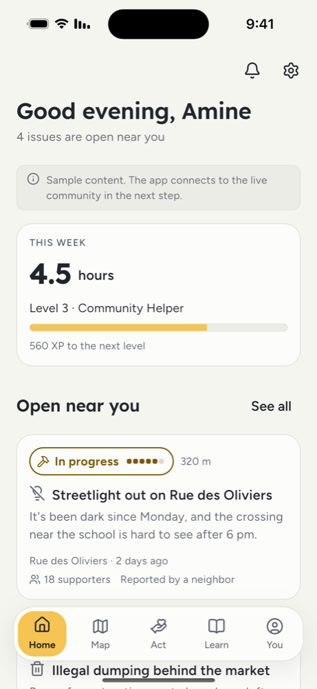
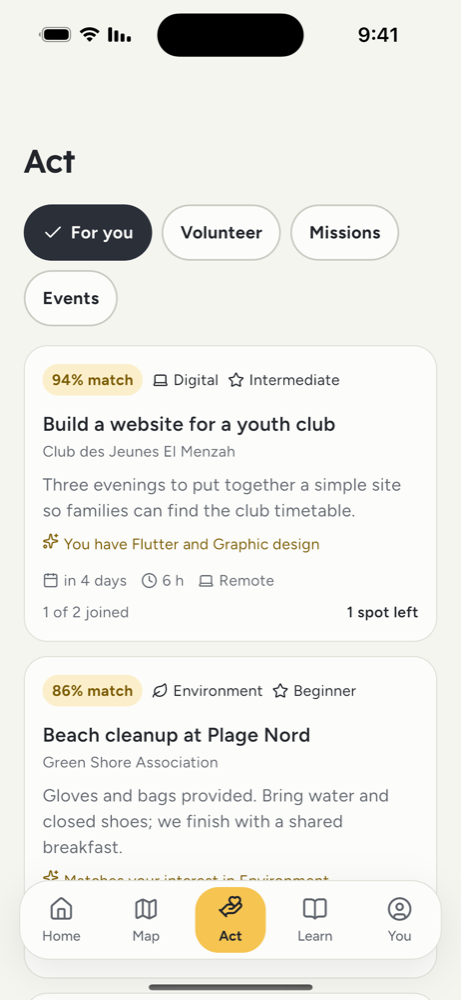
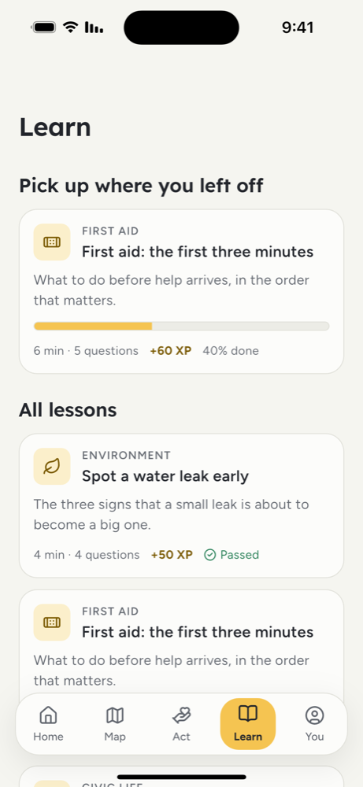

# civicos

A Flutter app that helps people take part in their local community: report and follow neighborhood issues, find volunteering and events, and learn practical civic skills.

## Screens

<p align="center">
  
  &nbsp;
  
  &nbsp;
  
</p>

| Home | Act | Learn |
| --- | --- | --- |
| Weekly impact, level progress, and issues open near you | Volunteering, missions and events matched to your skills | Short lessons with progress and XP |

## Getting started

```bash
cp env/development.json.example env/development.json
flutter pub get
flutter run --dart-define-from-file=env/development.json
```
